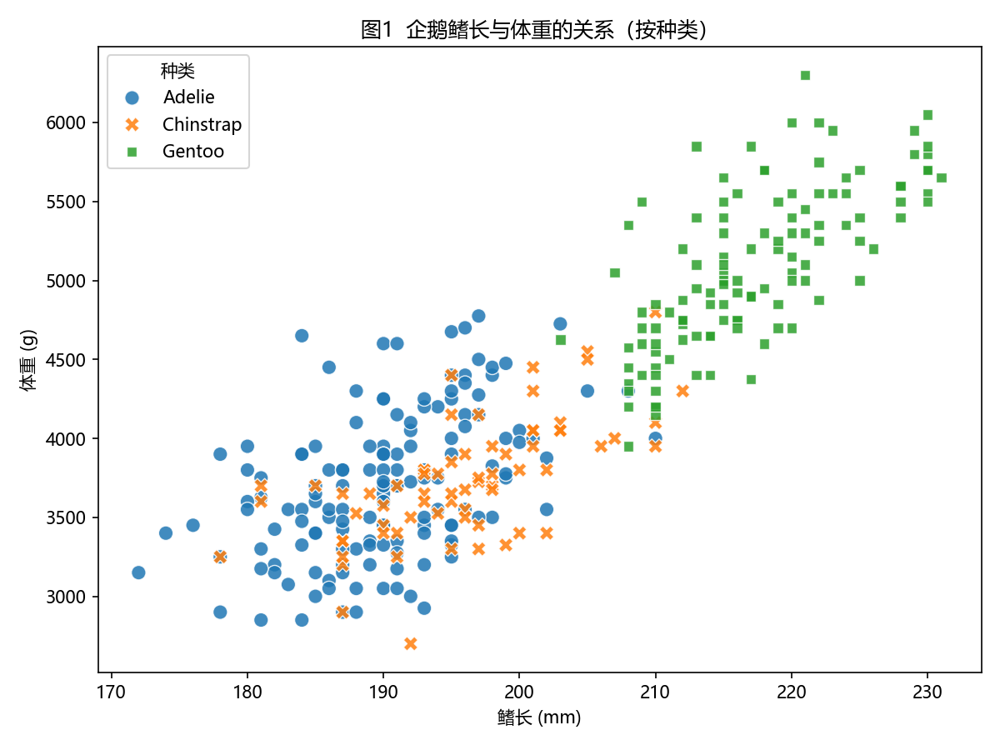
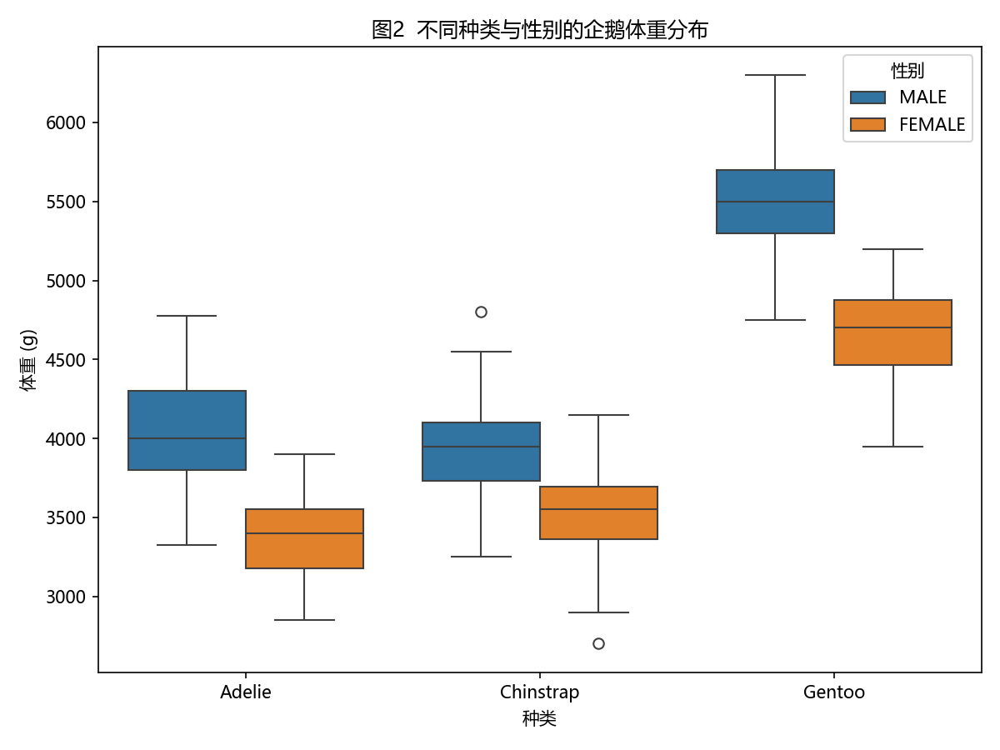
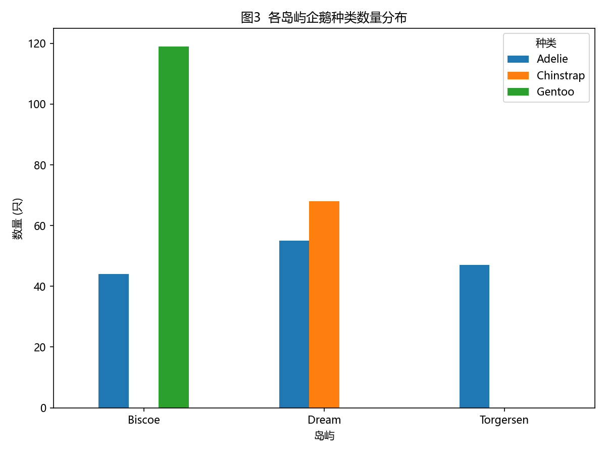

# Palmer Penguins 数据分析：用体型特征区分企鹅种类

## 1. 研究问题

不同种类的企鹅在体型特征（鳍长、体重、喙长、喙深）上存在多大差异？仅凭体型测量值能否有效区分 Adelie、Chinstrap 和 Gentoo 三个种类？

## 2. 数据集来源与使用权限

- **数据集**：Palmer Penguins（帕尔默企鹅）数据集
- **采集者**：Dr. Kristen Gorman 与 Palmer Station Long Term Ecological Research (LTER) 项目，2007–2009 年于南极洲帕尔默站附近三个岛屿（Torgersen、Biscoe、Dream）采集
- **原始出处**：Gorman, K. B., Williams, T. D., & Fraser, W. R. (2014). Ecological sexual dimorphism and environmental variability within a community of Antarctic penguins (genus *Pygoscelis*). *PLoS ONE*, 9(3).
- **许可协议**：CC0 1.0（公共领域），可自由使用、修改与发布，无需授权
- **本仓库中的数据文件**：`data/penguins.csv`（344 条观测记录，每条包含种类、岛屿、喙长、喙深、鳍长、体重、性别）

## 3. 方法与工具

| 环节 | 方法 | 工具 |
| --- | --- | --- |
| 数据清洗 | 删除关键字段（体型指标、性别）缺失的记录，344 → 333 条 | pandas |
| 描述性统计 | 按种类分组计算各体型指标均值 | pandas |
| 可视化 1 | 鳍长 vs 体重散点图，按种类着色 | matplotlib + seaborn |
| 可视化 2 | 按种类与性别分组的体重箱线图 | matplotlib + seaborn |
| 可视化 3 | 各岛屿企鹅种类数量分组柱状图 | matplotlib |

## 4. 关键发现

1. **Gentoo 企鹅体型明显更大**：平均体重约 5092 g，远高于 Adelie（约 3706 g）和 Chinstrap（约 3733 g）；在「鳍长—体重」二维空间中，Gentoo 与其他两种几乎完全分离（见图1）。
2. **Adelie 与 Chinstrap 体重相近，但喙形不同**：两者平均体重几乎一致，但 Chinstrap 平均喙长明显更长（48.8 mm vs 38.8 mm），喙形是比体重更好的区分特征。
3. **同种内雌雄体重差异稳定**：三种企鹅均表现为雄性重于雌性（见图2），性别是体重差异的重要来源。
4. **种类与岛屿分布高度相关**：Gentoo 仅出现在 Biscoe 岛，Chinstrap 仅出现在 Dream 岛，Adelie 在三个岛屿均有分布（见图3）。

### 可视化结果





## 5. 局限性

样本仅来自 2007–2009 年三个岛屿的 333 只成年企鹅，时间跨度短、地理范围小，且各岛屿样本量不均衡；因此结论不能直接外推到其他年份、其他种群或幼体企鹅。此外数据未包含环境因素（如海冰、食物丰度），无法解释体型差异的成因。

## 6. 运行说明

```bash
# 1. 克隆仓库
git clone https://github.com/<ChenWeiLin567>/data-science-project.git
cd data-science-project

# 2. 安装依赖（建议使用虚拟环境）
pip install -r requirements.txt

# 3. 运行分析（将在 figures/ 目录下重新生成 3 张图）
python analysis.py
```

运行后终端会输出清洗前后的记录数及各种类体型指标均值，`figures/` 目录下生成 `viz1_scatter.png`、`viz2_boxplot.png`、`viz3_island.png` 三张图。

## 7. 项目结构

```
data-science-project/
├── analysis.py          # 分析主脚本
├── requirements.txt     # Python 依赖
├── README.md            # 本文件
├── data/
│   └── penguins.csv     # 数据集（CC0）
└── figures/             # 可视化输出
    ├── viz1_scatter.png
    ├── viz2_boxplot.png
    └── viz3_island.png
```
